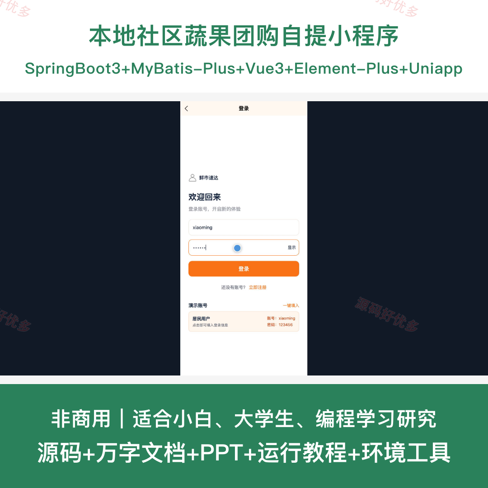
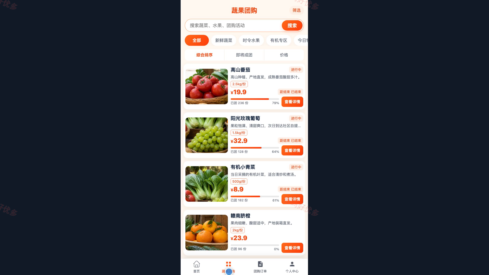
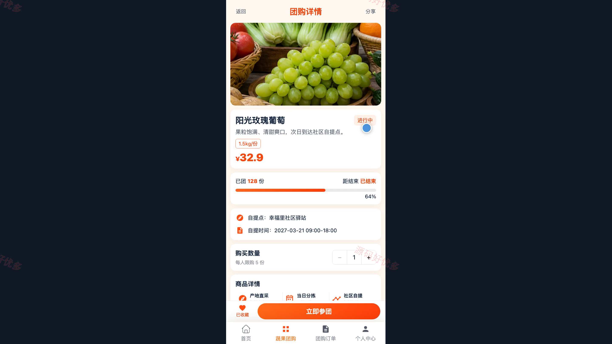
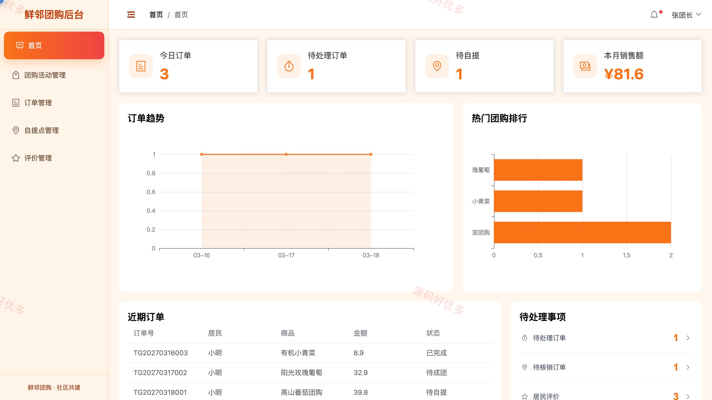
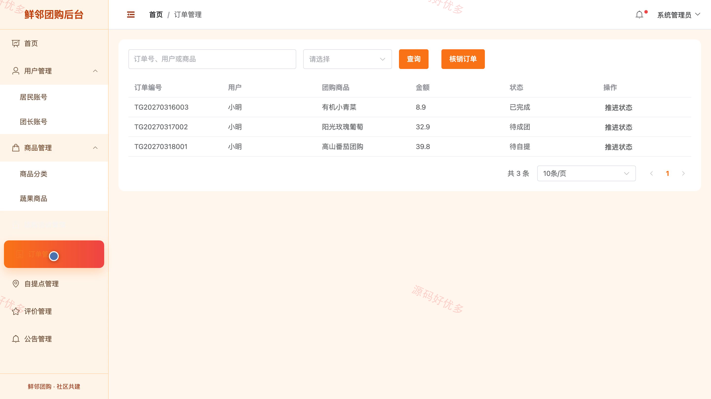

# bs046B
bs046B本地社区蔬果团购自提小程序源码JavaSpringBoot3Vue3文档PPT
## 源码问题查看主页咨询

### 一、关键词
社区团购、蔬果团购、生鲜预订、社区自提、团长运营

### 二、作品包含
源码+数据库+万字设计文档+PPT+全套环境和工具资源+本地部署教程

### 三、项目技术
前端技术： Html、Css、Js、Vue3.4、Element-Plus、uniapp
后端技术：Java、SpringBoot3.2.0、MyBatis-Plus

### 四、运行环境要求
开发工具：IDEA/eclipse + VSCODE + HBuilder X + 微信开发者工具

数据库：MySQL5.7+（共11张表）

数据库管理工具：Navicat10以上版本

环境配置软件： JDK17 + Maven3.6

前端Nodejs：16+

浏览器：谷歌浏览器

### 五、项目介绍
项目编号：bs046B

本地社区蔬果团购自提小程序面向社区居民、团长和管理员，提供蔬果浏览、团购下单、订单退款、社区自提、评价互动以及后台运营管理功能，支持居民从参团到自提的完整流程。

角色：社区居民、团长、管理员

社区居民功能：注册登录、蔬果与团购浏览、商品收藏、团购下单、订单与自提码查看、退款申请、订单评价、公告与个人信息查看。

团长功能：团购活动管理、订单处理、自提码核销、自提点管理、退款处理、评价回复、站点数据统计、个人信息维护。

管理员功能：居民与团长账号管理、商品分类与蔬果管理、团购活动管理、订单与退款管理、自提点管理、公告管理、评价管理、运营数据统计。

### 六、运行截图

